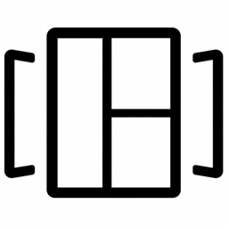

<p align="center">
  
</p>

# Minimal Slideshow integration

Bring your photo libraries to [Minimal Photo Slideshow](https://github.com/lukevink/minimal-slideshow) and control playback with Home Assistant automations.


## Photo sources

| Source | Connect with | Choose photos |
| --- | --- | --- |
| iCloud | Public shared-album link | Shared album |
| Google Photos | Shared-album link | Shared album |
| Immich | Server URL and read-only API key | Albums, people, favorites, library or search |
| PhotoPrism | Server URL and app password or account | Albums, people, favorites, library or search |
| Synology Photos | DSM URL and account | Personal/shared library, albums, people, places, tags, subjects or favorites |
| UGREEN Photos | UGOS server URL and account | Albums; experimental support |
| Nextcloud folder | Server URL, username and app password | WebDAV folder and optional subfolders |
| Nextcloud public album | Public Photos album link | Shared album |
| Ente Photos | Public album link with its decryption key | Shared album |
| Local folder / NAS | Folder accessible to Home Assistant | Folder and optional subfolders |
| Home Assistant Media Source | Folder selected in the media browser | Folder and subfolders |

## Install with HACS

Requires Home Assistant **2026.10.0 or newer**.

1. In **HACS → Custom repositories**, add `https://github.com/lukevink/minimal-slideshow-integration` with type **Integration**.
2. Download **Minimal Slideshow** and restart Home Assistant.
3. Open **Settings → Devices & services → Add integration → Minimal Slideshow**.
4. Choose a photo source and enter its connection details. Select albums or collections when prompted.
5. Install the [Minimal Photo Slideshow card](https://github.com/lukevink/minimal-slideshow) through HACS as a **Dashboard** repository.
6. Add the card to your dashboard and choose your photo source in its visual editor.

Add another integration entry for each additional source. Choose **Reconfigure** on an entry to update its connection details or photo selection.

**Manual installation:** copy `custom_components/minimal_slideshow` to `/config/custom_components/` and restart Home Assistant. Then continue from step 3.

## Connect your library

- **iCloud:** in Apple Photos, open a Shared Album, enable **Public Website**, and copy its link.
- **Google Photos:** enable link sharing for an album and copy its link.
- **Immich:** create a read-only API key with `server.about`, `asset.read`, `asset.view`, `asset.download`, `album.read`, and `person.read`. Optional search accepts JSON, such as `{"city":"Amsterdam"}`.
- **PhotoPrism:** use an app password or your account credentials. Optional search accepts queries such as `year:2025`.
- **Synology:** use an account with access to the desired Photos library. Enter a current two-factor code if prompted, then select a library and collections.
- **UGREEN:** enter your UGOS server address and account, then select one or more albums. Compatibility depends on the UGOS version.
- **Nextcloud:** use an app password for a WebDAV folder, or paste a public **Photos album** link. Turn off **Include subfolders** if your server restricts recursive listings.
- **Ente:** paste the complete public album link, including the key after `#`. Use an album with link access and no additional password. A custom Ente API origin can be entered for self-hosted libraries.
- **Local/NAS:** mount network storage in Home Assistant first. Choose a directory in `media_dirs` or add it to `homeassistant.allowlist_external_dirs`. Supported formats: JPEG, PNG, WebP, GIF, BMP and TIFF, displayed as still photos.
- **Media Source:** choose a folder from Home Assistant’s media browser.

Keep shared-album links and account credentials private. Configured photo sources are available to authenticated users of your Home Assistant instance.

## Automation controls

Each source creates three buttons and a photo-count sensor:

| Entity | Action |
| --- | --- |
| **Next Image** | Advance to the next photo change or layout. |
| **Previous Image** | Return to the previous photo composition. |
| **Restart** | Start the current shuffled playlist again. |
| **Photos** | Show the photo count and playback-command status. |

In an automation, add **Button: Press**, then select the button for your source. Commands apply to open cards displaying that source.

```yaml
actions:
  - action: button.press
    target:
      entity_id: button.family_photos_next_image
```

Use the actual entity ID shown in your installation.

## Card example

```yaml
type: custom:minimal-photo-slideshow
source: minimal_slideshow
effect: origami
interval: 8
duration: 1800
```

Select the source in the card’s visual editor. See the [card README](https://github.com/lukevink/minimal-slideshow) for animation, clock and layout options.

## License

[MIT](LICENSE). [Third-party notices](THIRD_PARTY_NOTICES.md) · [Preview photo credits](docs/PHOTO_CREDITS.md).

## Inspiration

Inspired by [Eyal Gal’s Album Slideshow](https://github.com/eyalgal/album_slideshow).
